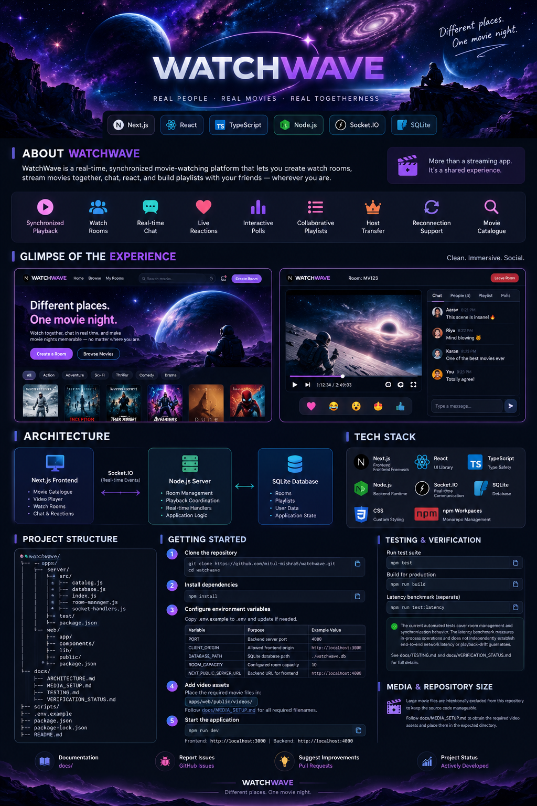

# 🌌 WatchWave — Different Places. One Movie Night.

<p align="center">
  
</p>

<p align="center">
  <strong>Better together.</strong>
  <br />
  A real-time movie-watching platform for sharing playback, conversations, reactions, and playlists with friends.
</p>

<p align="center">
  <a href="https://github.com/mitul-mishra5/watchwave">
    
  </a>
  
  
  
  
  
  
</p>

---

## ✨ Overview

Watching a movie together shouldn't require everyone to be in the same room.

**WatchWave** is a full-stack web application designed to make remote movie nights more interactive. Users can create shared watch rooms, coordinate video playback, communicate in real time, react to moments, participate in polls, and collaboratively manage playlists.

The application combines a Next.js frontend with a Node.js backend, Socket.IO-based real-time communication, and SQLite for local application data persistence.

The goal is simple: bring the social experience of a movie night into one shared online space.

## 🚀 Features

| Feature | Description |
|---|---|
| 🎬 Synchronized playback | Coordinate playback actions across participants in a shared room. |
| 🏠 Watch rooms | Create and join shared viewing sessions. |
| 💬 Real-time chat | Exchange messages while watching together. |
| ❤️ Reactions | Share reactions during a viewing session. |
| 📊 Interactive polls | Let room participants vote on shared decisions. |
| 🎞️ Collaborative playlists | Add and manage movies together. |
| 👑 Host transfer | Transfer room hosting to another participant. |
| 🔄 Room recovery | Support rejoining after refresh or reconnection. |
| 🔎 Movie catalogue | Browse available titles and choose what to watch. |
| 🌌 Cinematic interface | Explore a dark, space-inspired design built around the viewing experience. |

## 🧠 How WatchWave Works

WatchWave has three main architectural components.

### 1. Frontend

The Next.js application provides the user interface for the movie catalogue, watch rooms, video player, chat, reactions, polls, and collaborative playlists.

### 2. Real-time backend

The Node.js server manages room-related operations and communicates with connected clients through Socket.IO events. This allows room interactions to be coordinated without requiring users to reload the application.

### 3. Data persistence

SQLite provides local application data persistence. The database configuration determines where the application stores its data.

### Playback synchronization

When participants interact with playback controls, the application coordinates relevant playback actions through its real-time communication layer. Actual synchronization quality depends on network conditions, browser playback behavior, and client timing.

End-to-end latency and playback drift require separate multi-client measurements; they should not be inferred solely from successful local playback.

## 🏗️ Architecture

```text
┌──────────────────────────────────────────┐
│              Next.js Frontend            │
│                                          │
│ Catalogue · Watch Rooms · Video Player   │
│ Chat · Reactions · Polls · Playlists     │
└────────────────────┬─────────────────────┘
                     │
                HTTP / Socket.IO
                     │
┌────────────────────▼─────────────────────┐
│               Node.js Server             │
│                                          │
│ Room Management · Event Handlers         │
│ Real-time Application Coordination       │
└────────────────────┬─────────────────────┘
                     │
┌────────────────────▼─────────────────────┐
│                 SQLite                   │
│                                          │
│          Persistent Application Data     │
└──────────────────────────────────────────┘
```

This is a high-level conceptual diagram. The exact responsibilities of the database and individual event handlers are defined by the source implementation.

## 🛠️ Technology Stack

| Technology | Purpose |
|---|---|
| Next.js | Web application framework |
| React | Component-based user interface |
| TypeScript | Frontend type safety |
| Node.js | Backend runtime |
| Socket.IO | Real-time, bidirectional communication |
| SQLite | Local data persistence |
| CSS | Custom interface styling |
| npm workspaces | Monorepo package management |

## 📂 Project Structure

```text
watchwave/
├── apps/
│   ├── server/
│   │   ├── src/
│   │   │   ├── catalog.js
│   │   │   ├── database.js
│   │   │   ├── index.js
│   │   │   ├── room-manager.js
│   │   │   └── socket-handlers.js
│   │   ├── test/
│   │   │   ├── latency.test.js
│   │   │   └── room-manager.test.js
│   │   └── package.json
│   │
│   └── web/
│       ├── app/
│       │   ├── globals.css
│       │   ├── layout.tsx
│       │   ├── page.tsx
│       │   └── room/
│       ├── components/
│       ├── lib/
│       ├── public/
│       └── package.json
│
├── docs/
│   ├── images/
│   ├── ARCHITECTURE.md
│   ├── MEDIA_SETUP.md
│   ├── TESTING.md
│   └── VERIFICATION_STATUS.md
│
├── scripts/
├── .env.example
├── .gitignore
├── package.json
├── package-lock.json
├── README.md
└── start-windows.bat
```

## ⚡ Getting Started

### Prerequisites

- Node.js and npm
- Git
- A supported development environment
- The required local video assets for full catalogue playback

### 1. Clone the repository

```bash
git clone https://github.com/mitul-mishra5/watchwave.git
cd watchwave
```

### 2. Install dependencies

Run this command from the project root:

```bash
npm install
```

### 3. Configure the environment

Refer to [`.env.example`](.env.example) for the supported environment variables.

| Variable | Purpose | Example |
|---|---|---|
| `PORT` | Backend server port | `4000` |
| `CLIENT_ORIGIN` | Allowed frontend origin | `http://localhost:3000` |
| `DATABASE_PATH` | SQLite database path | `./watchwave.db` |
| `ROOM_CAPACITY` | Configured room capacity | `10` |
| `NEXT_PUBLIC_SERVER_URL` | Backend URL used by the frontend | `http://localhost:4000` |

These values describe the example local-development configuration. Check the package scripts and configuration before changing ports or environment-file locations. Never commit real credentials or secrets.

### 4. Set up the media assets

Large movie files are intentionally excluded from Git to keep the source repository manageable.

The catalogue expects its video assets under:

```text
apps/web/public/videos/
```

Follow [`docs/MEDIA_SETUP.md`](docs/MEDIA_SETUP.md) for the required filenames and setup instructions.

Without the required media files, playback for titles whose assets are missing will not work as intended.

### 5. Start the application

From the project root, run:

```bash
npm run dev
```

Open the frontend at `http://localhost:3000` if that is the URL reported by the development server. The example configuration uses port `4000` for the backend.

## 🧪 Testing and Verification

Run the automated tests:

```bash
npm test
```

Build the application:

```bash
npm run build
```

Run the separate latency benchmark, if available in the root scripts:

```bash
npm run test:latency
```

The repository contains tests for room-management behavior and a latency microbenchmark. Local manual testing has covered movie selection, playback, chat, reactions, polls, playlists, host transfer, and room rejoining.

The automated tests previously passed nine tests, and the production build previously succeeded. Re-run both commands against the latest changes to confirm the current state.

**Performance limitations:** The in-process latency benchmark does not measure complete browser-to-browser network latency. It does not independently establish a 250 ms end-to-end latency guarantee or a 500 ms playback-drift guarantee. Formal multi-client load testing and end-to-end synchronization measurements remain separate validation tasks.

For further details, see [`docs/TESTING.md`](docs/TESTING.md) and [`docs/VERIFICATION_STATUS.md`](docs/VERIFICATION_STATUS.md).

## 🗃️ Media and Repository Size

This repository contains the application's source code, tests, configuration, and documentation. Large movie assets are stored separately and must be made available locally for full catalogue playback.

Keeping media outside Git avoids unnecessary repository growth and makes source-code updates smaller.

## 🔐 Security and Configuration

- Do not commit real `.env` files, passwords, API keys, or credentials.
- Use `.env.example` as a configuration reference.
- Keep generated database files and temporary SQLite sidecar files out of version control.
- Configure allowed origins and deployment settings appropriately before exposing the application publicly.
- Review authentication, room access, input validation, and production security requirements before deploying.

## 🛣️ Future Improvements

Potential directions for further development include:

- A publicly deployed demonstration environment
- External media hosting and production media configuration
- Multi-client load testing and playback-drift measurement
- More robust recovery from network failures
- Additional accessibility and responsive-design improvements
- Automated builds and tests through continuous integration

These are potential improvements, not claims that they have already been implemented.

## 📚 Documentation

- [Architecture](docs/ARCHITECTURE.md)
- [Media setup](docs/MEDIA_SETUP.md)
- [Testing guide](docs/TESTING.md)
- [Verification status](docs/VERIFICATION_STATUS.md)

## 🤝 Contributing

Suggestions, bug reports, and improvements are welcome.

1. Fork the repository.
2. Create a branch for your change.
3. Make and test your changes.
4. Open a pull request describing the improvement.

## 📄 License

No open-source license has been specified in this repository. Until a license is added, permission to reuse or redistribute the code should not be assumed.

---

<p align="center">
  <strong>WATCHWAVE</strong>
  <br />
  <em>Different places. One movie night.</em>
</p>
